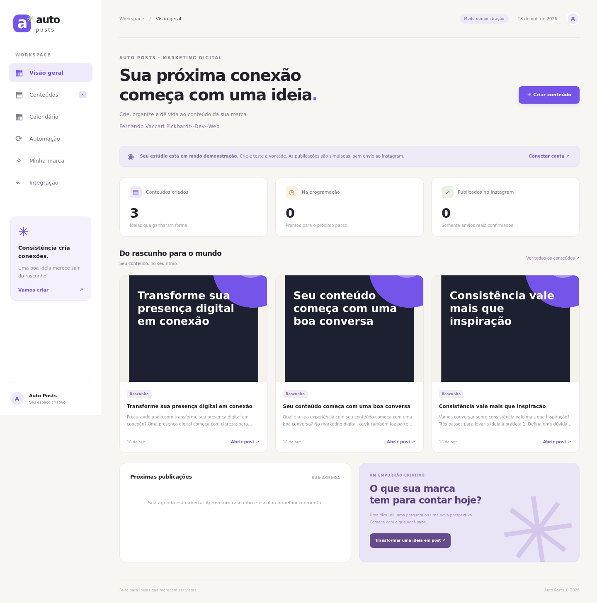

# Auto Posts

Estúdio de criação e publicação de conteúdo para Instagram, voltado ao público de **marketing digital**.

**Fernando Vaccari Pickhardt--Dev--Web** aparece na capa do painel e nas artes. Nome, assinatura, público, tom, cor e chamada para ação são editáveis em **Minha marca**.

[Baixar o projeto em ZIP](auto-posts.zip) · [Guia de implantação gratuita](docs/cloud-free.md)

## Estúdio de Reels para RPG no Roblox — Fases 1 e 2

O repositório agora inclui um módulo local de edição para Ubuntu 24.04, mantendo o painel, autenticação, SQLite, agendamentos e integração Meta existentes. Ele importa MP4/MOV/WebM reais, cria roteiros pt-BR baseados nos temas declarados das gravações, narra offline com eSpeak NG ou Piper local e exporta Reels de 15 a 60 segundos em 1080×1920, H.264/AAC, com legendas sincronizadas, cortes, zoom leve e trilha opcional.

```bash
bash scripts/install-reels.sh
.venv/bin/python -m app.reels --help
.venv/bin/python scripts/reels_smoke.py  # teste sintético, não é gameplay do Roblox
```

[Como gerar seu primeiro Reel com gameplay real](docs/reels.md) · [Arquitetura, limites e próximas fases](docs/reels.md#limites-e-próximas-fases)

A página **Estúdio de Reels** já permite importar, configurar, gerar, acompanhar, cancelar, reproduzir e baixar pelo navegador, com login obrigatório. [Instalação e uso da Fase 2](docs/reels-web.md). A CLI da Fase 1 permanece disponível. **Reels não são publicados ou agendados automaticamente nesta entrega.** Os horários 12h30/19h30, de segunda a sábado em São Paulo, estão documentados como configuração futura desativada. O uso local não exige GPU dedicada ou APIs pagas e não pressupõe Roblox Studio nativo no Ubuntu.



## O que está implementado

- Painel em português, responsivo, com biblioteca, filtros, calendário e histórico.
- Legendas por modelos locais ou, opcionalmente, pela API da OpenAI.
- Artes JPEG 1080 × 1350 com identidade e assinatura; upload de imagens próprias.
- Edição de texto e descrição acessível, revisão e aprovação explícitas.
- Agendamento persistente em SQLite, com fila verificada a cada 15 segundos.
- Rotina recorrente: escolha temas, dias e horário e autorize a criação e o envio sem revisão individual. Começa desativada e funciona em demonstração ou modo real.
- Publicação de **imagem única no feed** pela Instagram API com Facebook Login: criação do contêiner, espera do processamento e publicação.
- Demonstração separada dos envios reais, autenticação e proteção contra reenvios ambíguos.

A integração Meta existente usa um token configurado pelo responsável pela conta. Ela não inclui OAuth self-service, publicação de Reels, Stories, carrosséis ou múltiplos clientes. O novo Estúdio edita vídeos fornecidos localmente; não inventa gameplay nem usa geração de vídeo por IA. Textos locais são modelos editáveis; revise informações, relevância e direitos de uso antes de aprovar.

## Executar localmente

Requisitos: Linux e Python 3.12 ou superior com `venv`. Node.js só verifica a sintaxe do JavaScript. Não há compilação do frontend, banco externo ou chave de IA obrigatória.

```bash
cd /workspace/auto-dev-marketing
bash scripts/install.sh
.venv/bin/python -m app.seed  # opcional; cria exemplos apenas quando o banco está vazio
.venv/bin/python -m app
```

O servidor escuta na porta 8000, somente na interface local por padrão. Valide com `curl --fail http://127.0.0.1:8000/health`. No seu computador, use o navegador na mesma porta. O onboarding usa requisições locais e não fornece uma prévia pública.

O modo padrão é `demo`: criação, edição, aprovação, agendamento e simulação funcionam sem conta Meta. O resultado é **Simulado**, sem ID de mídia e sem chamada de publicação à Meta. Os exemplos não são aprovados ou agendados automaticamente.

O app lê variáveis de processo e não carrega `.env` automaticamente. `.env.example` lista os nomes. Em desenvolvimento local, carregue um arquivo ignorado pelo Git com `set -a; source .env; set +a`. Na nuvem, use as configurações seguras do ambiente. Nunca versione credenciais.

## Custo zero e nuvem gratuita

O fluxo padrão usa modelos de texto e artes locais: não exige assinatura nem API de IA paga. Deixe `AI_API_KEY` ausente para manter esse comportamento. A integração opcional com IA pode gerar cobrança no provedor quando configurada e não faz parte da implantação gratuita.

Para nuvem sem mensalidade, a opção recomendada para esta arquitetura é uma VM **Oracle Cloud Always Free**, dentro das cotas, com **DuckDNS** e **Caddy** para endereço e HTTPS gratuitos. O cadastro pode exigir cartão para verificação, há restrições de capacidade e instâncias ociosas podem ser recuperadas pelo provedor. A disponibilidade e a elegibilidade precisam ser confirmadas no painel antes de criar recursos; não ative serviços pagos ou upgrade de faturamento.

Veja o roteiro completo em [Implantação gratuita](docs/cloud-free.md). Nenhum serviço externo foi contratado, e nenhum domínio ou recurso de nuvem foi criado. Hospedagens que suspendem o processo ou apagam o disco não mantêm o agendamento e os dados desta versão de forma confiável.

## Configuração

| Variável | Uso | Padrão |
| --- | --- | --- |
| `APP_MODE` | `demo` ou `live` | `demo` |
| `DATA_DIR` | Banco, imagens, chave de sessão e trava | `.data` |
| `APP_HOST` / `APP_PORT` | Interface e porta | `127.0.0.1` / `8000` |
| `APP_TIMEZONE` | Fuso do calendário e histórico | `America/Sao_Paulo` |
| `APP_PASSWORD` | Senha do painel; obrigatória para Reels, no modo real ou ao expor o servidor | Sem valor |
| `META_ACCESS_TOKEN` | Token com acesso à conta profissional | Sem valor |
| `INSTAGRAM_ACCOUNT_ID` | ID numérico da conta Instagram profissional | Sem valor |
| `PUBLIC_BASE_URL` | Origem HTTPS pública, sem caminho | Sem valor |
| `META_API_VERSION` | Versão suportada da Graph API | `v25.0` |
| `AI_API_KEY` | Chave opcional para textos na OpenAI | Sem valor |
| `AI_MODEL` | Modelo compatível com Chat Completions e JSON | `gpt-4o-mini` |

Datas são armazenadas em UTC. O campo de agendamento usa o fuso do navegador, identificado ao lado do campo; calendário e histórico usam `APP_TIMEZONE`. O servidor precisa permanecer em execução. Agendamentos vencidos são processados no retorno do serviço, desde que ainda aprovados no mesmo modo.

## Rotina automática

Em **Automação**, informe até 14 temas, os dias e o horário. Para ativar, marque a autorização de criação e envio sem revisão individual e salve. Em demonstração, o resultado é simulado; em modo real, a rotina publica na conta configurada. Sem essa autorização, a rotina permanece desativada.

Há no máximo uma execução por dia escolhido e modo, mesmo se você alterar o horário. Os temas se alternam e a autorização vale a partir da próxima ocorrência após salvar. Ao reiniciar, só a ocorrência pendente do dia atual é recuperada; dias anteriores não geram uma sequência de posts atrasados. Erros não são reenviados automaticamente e aparecem no histórico de execuções.

Salvar a identidade da marca desativa a rotina. Trocar modo ou ID da conta exige nova autorização. Desativar a rotina impede as próximas execuções; um envio que já começou pode terminar. Os conteúdos criados ficam na biblioteca para conferência.

## Conectar a Meta e publicar de verdade

1. Use uma conta profissional Instagram **Business ou Creator**, vinculada a uma Página do Facebook, e um app Meta preparado para **Instagram API com Facebook Login**.
2. Configure acesso aos ativos e as permissões aplicáveis, incluindo `instagram_basic`, `instagram_content_publish`, `pages_show_list` e `pages_read_engagement`. Confira as exigências no painel oficial. Para contas fora dos papéis do app, podem ser necessários análise, acesso avançado e verificação da empresa.
3. Obtenha um token pelo fluxo oficial do app. Consulte `GET /me/accounts?fields=id,name,instagram_business_account` na Graph API para identificar a Página e a conta profissional. Não use o nome de usuário ou o ID da Página como `INSTAGRAM_ACCOUNT_ID`.
4. Configure `META_ACCESS_TOKEN`, `INSTAGRAM_ACCOUNT_ID`, `PUBLIC_BASE_URL`, uma `APP_PASSWORD` de pelo menos 12 caracteres e `APP_MODE=live`. O app recusa iniciar em modo real se faltarem requisitos. As chamadas usam HTTPS com verificação de certificado e token no cabeçalho Authorization.
5. Hospede o serviço em um domínio HTTPS. A Meta precisa buscar `/media/<id>.jpg` sem autenticação. O painel continua protegido. Não configure no proxy uma autenticação global que bloqueie as imagens.
6. Reinicie e clique em **Verificar conexão**, na tela **Integração**. Essa leitura confirma acesso à conta; sozinha, não comprova permissão de publicação nem acesso da Meta à imagem.
7. Crie, revise e aprove um rascunho para publicar ou agendar. **Publicado** só aparece após a Meta retornar um ID de mídia. A validação real exige esse envio autorizado e a conferência na conta.

Tokens expiram e podem ser revogados. Renove-os pelo fluxo oficial e atualize a configuração; o app não renova credenciais automaticamente. Não há reenvios automáticos após erros. O estado **Conferir no Instagram** bloqueia nova tentativa no registro: a Meta pode ter publicado antes de uma queda de conexão. Confira a conta antes de criar outro rascunho.

Editar conteúdo agendado remove a aprovação e volta o registro a rascunho. Ao trocar entre `demo` e `live`, cancele e aprove novamente os agendamentos do modo anterior; eles nunca são convertidos automaticamente em envios reais.

Documentação: [Publicação de conteúdo](https://developers.facebook.com/docs/instagram-platform/instagram-api-with-facebook-login/content-publishing/) · [Introdução à API](https://developers.facebook.com/docs/instagram-platform/instagram-api-with-facebook-login/).

## Hospedagem com HTTPS

O projeto inclui `Dockerfile`, `compose.yaml` e `deploy/Caddyfile`. Em um servidor Linux com Docker Compose, aponte o DNS para o servidor, libere 80/443 e forneça `APP_DOMAIN`, `APP_PASSWORD` e as variáveis da integração pelo ambiente seguro. Execute:

```bash
docker compose up -d --build
docker compose ps
```

O Caddy administra o certificado HTTPS e `app_data` persiste os dados. A porta interna do app não deve ser exposta diretamente. É possível hospedar em modo demonstração, com senha, antes de ativar os envios reais. O domínio e a hospedagem precisam ser fornecidos pelo responsável; esses arquivos não criam infraestrutura externa.

Execute **uma única réplica, com um único processo**, por diretório de dados. Uma trava local impede workers simultâneos. SQLite exige disco local persistente; não use réplicas distribuídas ou NFS. Alta disponibilidade e múltiplos clientes exigem outra arquitetura de banco, fila e autenticação.

O painel usa um administrador e sessões de 12 horas. Use HTTPS em produção. Trocar `APP_PASSWORD` invalida sessões antigas após reiniciar. `/health` é público e retorna apenas a saúde básica do serviço.

## Testar

```bash
.venv/bin/python -m unittest discover -v
.venv/bin/python -m pip check
node --check app/web/app.js
node --check app/web/login.js
```

O teste adicional de interface usa Playwright e dados temporários:

```bash
.venv/bin/python -m pip install -r requirements-dev.txt
.venv/bin/python -m playwright install chromium
.venv/bin/python scripts/browser_smoke.py
```

Se já houver Chromium no sistema, use `BROWSER_EXECUTABLE=/usr/bin/chromium`. O teste não altera o banco de desenvolvimento e não acessa a Meta.

Os testes usam bancos temporários e HTTP simulado. Cobrem identidade e JPEG, upload, revisão, aprovação, edição, cancelamento, scheduler em background, rotina recorrente, persistência, concorrência, recuperação de reinício, separação de modos/contas, autenticação, Graph API e IA. Não publicam nem consomem créditos de IA.

`.github/workflows/ci.yml` executa a suíte em pushes e pull requests. Testes locais não comprovam execução no GitHub Actions, no Docker ou publicação real na Meta.

Os resultados executados nesta entrega estão em [Validação](docs/validation.md). Para gerar um pacote de código sem banco, ambiente virtual ou credenciais, execute `python3 scripts/package.py`.

## Dados e backup

Todo estado fica em `DATA_DIR`, ignorado pelo Git. Inclua banco, imagens e chave de sessão no backup. Pare o serviço antes de copiar o diretório completo, ou use a API de backup do SQLite e copie as imagens. Não remova imagens que possam estar em processamento pela Meta. Teste a restauração na hospedagem escolhida.

## Estrutura

```text
app/config.py       Configuração e validação do modo real
app/db.py           Persistência, fila e histórico
app/content.py      Legendas e artes JPEG
app/meta.py         Cliente da Graph API
app/publisher.py    Processamento da fila
app/automation.py   Rotina recorrente de criação e publicação
app/main.py         HTTP, autenticação e endpoints
app/web/            Painel HTML, CSS e JavaScript
tests/              Testes funcionais e integração simulada
deploy/             Proxy HTTPS
```
