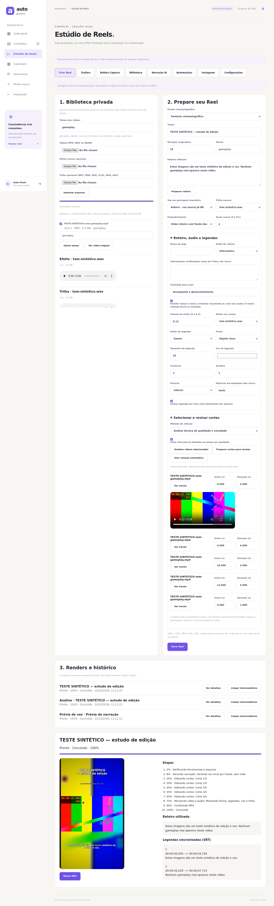

# Auto Posts — produção local de trailers para Roblox

Esta versão estende as Fases 1 e 2. Preserva painel, banco, sessão, automação e publicação de imagens e acrescenta produção cinematográfica, captura assistida, narração neural, análise de vídeos, agendamentos e publicação oficial de Reels.

O sistema pode gerar e editar sem internet depois da instalação. Instagram requer conexão, conta profissional compatível e aplicativo/permissões configurados. Nenhuma conta, domínio, hospedagem, crédito de IA ou serviço pago é contratado pelos instaladores. O Estúdio não usa `AI_API_KEY`; para manter também as rotinas legadas de imagens sem APIs pagas, deixe essa chave opcional ausente no seu ambiente. **Não houve publicação real nem captura de um jogo Roblox real na validação desta entrega.**



## Instalar, iniciar, testar e diagnosticar

Ubuntu 24.04, Python 3.12, CPU e SSD. Não exige Radeon dedicada, NVIDIA ou CUDA. Use o checkout atualizado e preserve seu `.env` e `DATA_DIR`:

```bash
cd auto-dev-marketing
# Somente se você já possui um .env confiável criado por você:
if [ -f .env ]; then
  set -a
  source .env
  set +a
fi
bash scripts/auto-posts instalar --com-obs
```

O instalador instala os requisitos existentes, FFmpeg/eSpeak NG quando ausentes, dependências das integrações e Kokoro ONNX em CPU. Baixa aproximadamente 338 MiB de modelos de um release fixo e verifica SHA-256. `--com-obs` acrescenta OBS Studio pelos pacotes oficiais do Ubuntu e pode solicitar sua senha administrativa pelo `sudo` local. Sem esse argumento, você pode instalar OBS posteriormente; geração e edição não dependem dele. Instalação inicial exige internet e espaço livre. Nunca sobrescreve `.env`, credenciais ou banco.

Se já há senha do painel no seu ambiente, mantenha-a. Se não houver:

```bash
if [ -z "${APP_PASSWORD:-}" ]; then
  read -rsp 'Senha do painel (mínimo 12 caracteres): ' APP_PASSWORD
  echo
  export APP_PASSWORD
fi
bash scripts/auto-posts iniciar
```

Abra **http://127.0.0.1:8000** no navegador do computador que executa o servidor. Confira `curl --fail http://127.0.0.1:8000/health`. O servidor usa um único worker e precisa continuar ligado para executar horários. Não use recarga automática durante renders. Não é um serviço na nuvem nem uma prévia pública deste ambiente de desenvolvimento.

```bash
bash scripts/auto-posts diagnosticar
bash scripts/auto-posts testar
```

A senha inicial e a instalação administrativa são preparadas no ambiente local. Depois disso, mídia, voz, efeitos, regras, OBS, credenciais Meta e limites são configurados pelo navegador. `APP_MODE` continua controlando as imagens existentes. **Reels têm modo próprio em Instagram → Modo dos Reels, inicialmente Demonstração**, sem alterar a configuração das imagens.

## Como criar o primeiro trailer

1. Entre e abra **Estúdio de Reels → Criar Reel**. Importe MP4/MOV/WebM e declare somente temas que realmente aparecem no vídeo. Música e efeitos sonoros são opcionais e fornecidos por você.
2. Na biblioteca, selecione os vídeos. Pode corrigir os temas com **Salvar temas**, sem reenviar a gravação. Originais pessoais não são modificados. **Ver vídeo original** e os players de trilha/efeito permitem conferir o material em rotas privadas autenticadas.
3. Em **Trailers**, escolha um dos oito presets. Ele aplica ritmo de cortes, zoom e volume de trilha; o render usa a correção de cor, transição, tipografia e animações correspondentes. O acabamento depende da qualidade das tomadas gravadas.
4. Defina título, 15–60 segundos, enquadramento e roteiro. **Preparar roteiro** cria uma variação local editável. Configure nome do jogo, estilo, chamada e informações confirmadas na seção expansível. Os templates não acrescentam lançamentos, personagens ou mecânicas.
5. Em **Narração IA**, ouça uma prévia. O motor é selecionado em Criar Reel; Kokoro é escolhido quando instalado. Ajuste velocidade de 0,85 a 1,15 e volume de 0,5 a 1,5. Volte a Criar Reel para finalizar.
6. Em **Selecionar e revisar cortes**, execute a análise e prepare os cortes. A seleção técnica é o padrão da página; a CLI clássica permanece sequencial. Revise início/duração em segundos, mantendo a duração total; **Ver trecho** reproduz o intervalo da gravação privada no navegador. **Usar seleção automática** remove a revisão fixa.
7. Escolha música, efeitos, estilo de legenda, tamanho, cor, contorno, sombra, posição e destaque de palavras. Os estilos são cinematográfico, gamer, moderno e minimalista. Animação e sincronização são por frase. Destaques coloridos não fingem alinhamento de palavra a palavra.
8. Clique **Gerar Reel**. A fila é sequencial, persiste no SQLite e não bloqueia FastAPI. Consulte progresso, etapas, falhas, roteiro/SRT utilizados, vídeo e download autenticado. Pode cancelar somente aquele job.
9. Revise o MP4. A geração não publica diretamente. Para enviar, use a seção Instagram e sua política de aprovação.

## Voz neural escolhida e licenças

Escolha: **Kokoro-82M v1.0, ONNX em CPU**, integração `kokoro-onnx==0.6.1`, vozes pt-BR `pf_dora`, `pm_alex`, `pm_santa`; padrão Dora. A documentação upstream identifica o idioma `p` como português brasileiro. O pacote é carregado localmente, com `lang='pt-br'`, provedor `CPUExecutionProvider`, uma thread entre operadores e limite de threads intraoperador. Não há clonagem, gravação da sua voz, perfis pessoais ou APIs pagas.

O README do autor identifica os pesos como Apache; o repositório fornece Apache 2.0. A conversão/integração ONNX identifica o modelo como Apache 2.0 e seu próprio código como MIT. São licenças que permitem uso comercial, com cumprimento dos termos ao redistribuir componentes. Incluímos [Apache 2.0](licenses/Kokoro-Apache-2.0.txt) e [MIT](licenses/kokoro-onnx-MIT.txt). Isso não dá direitos sobre músicas, imagens, marcas ou vozes de terceiros que você adicionar.

Componentes auxiliares têm licenças próprias: ONNX Runtime declara MIT; Phonemizer/eSpeak NG usam GPL; websockets usa BSD-3-Clause; cryptography usa Apache-2.0 ou BSD-3-Clause. Os instaladores obtêm esses componentes de seus distribuidores e não os incluem no ZIP do projeto. Consulte os termos upstream caso redistribua uma instalação completa. [Fontes e hashes consultados](referencias-tecnicas.md).

Piper continua compatível como alternativa já existente. O motor upstream atual declara GPL 3; cada voz Piper possui seus próprios termos. Como o cartão da voz pt-BR no Hugging Face não pôde ser consultado neste ambiente, não indicamos uma voz Piper específica como liberada comercialmente. O caminho recomendado e validado nesta entrega é Kokoro. A naturalidade e a pronúncia devem ser avaliadas por você na prévia, especialmente para nomes inventados do seu RPG.

Instalar somente a voz neural, preservando o resto:

```bash
.venv/bin/python -m pip install -r requirements-reels-kokoro.txt
.venv/bin/python scripts/install_voice.py
```

Arquivos esperados em `DATA_DIR/reels/models/kokoro`:

| Arquivo | SHA-256 |
| --- | --- |
| `kokoro-v1.0.onnx` | `beb0d1848dee9a49da392cc3df26958d46cfa35d321edf434f52949153f0df3a` |
| `voices-v1.0.bin` | `bca610b8308e8d99f32e6fe4197e7ec01679264efed0cac9140fe9c29f1fbf7d` |

O instalador recusa arquivos existentes com outro hash, não os sobrescreve, usa TLS e temporário exclusivo. O render não baixa arquivos. O modelo é liberado da memória antes da montagem FFmpeg.

### Narração curta e áudio

A narração é sintetizada por frases, normalizada, limitada em pico e tem os silêncios de borda removidos. Pausas entre frases são limitadas; não se corta áudio no meio de palavras. A velocidade é um ajuste explícito do usuário, nunca uma solução automática para texto longo.

Cada WAV é medido. Se a fala não couber e **Permitir reduzir o texto** estiver marcado, o sistema reduz o texto e sintetiza novamente, até quatro tentativas no total. Confirme o roteiro realmente utilizado no resultado; uma redução pode remover informações. Desmarque a opção para preservar seu texto e receber erro se não couber. O teste neural usa um roteiro propositalmente longo, verifica mais de uma tentativa, fala menor que 14 segundos no Reel de 15 e nenhuma aceleração automática.

As legendas usam os tempos do áudio normalizado medido. A voz termina antes da borda final do vídeo. O mixer faz ducking por sidechain, fades da trilha, controle de volume e limitação final de picos. Efeitos próprios são aplicados nos cortes, com até 12 ocorrências por Reel. O áudio original do gameplay permanece silenciado. Não há download de músicas protegidas.

## Motor cinematográfico e seleção

| Preset | Característica |
| --- | --- |
| Medieval épico | Cortes de até 3,5 s, contraste moderado e dourado |
| Fantasia cinematográfica | Cortes de até 4 s, dissolve, paleta suave |
| Mistério | Ritmo mais lento, saturação reduzida e vinheta |
| Combate | Cortes de até 2 s e legendas mais marcantes |
| Exploração | Planos mais longos e dissolve |
| Diário de desenvolvimento | Montagem discreta e legenda minimalista |
| Atualização do jogo | Ritmo intermediário e apresentação direta |
| Trailer curto para Instagram | Cortes curtos, zoom e abertura/encerramento |

A edição clássica continua disponível. Presets novos usam abertura e encerramento sobre suas imagens, animação leve de títulos/legendas e filtros de contraste, saturação, nitidez ou vinheta conforme o preset. Enquadramentos: vídeo inteiro com margens, recorte central e fundo desfocado. Não há geração de gameplay artificial.

Dissolves usam sobreposição real de seis frames. Se não houver gravação suficiente para manter a duração com sobreposição, o planejamento usa fade e informa o motivo. A soma de cortes revisados deve levar essa sobreposição em conta. Cortes repetidos ou que saiam da gravação são recusados.

A análise amostra no máximo 60 frames de 160×90, até os primeiros 10 minutos por arquivo, medindo movimento, exposição e bordas. Usa hashes visuais para diversidade e intervalos registrados para evitar repetição. **Movimento não equivale a compreensão semântica**. As tags são declarações suas, não classificação automática de demônios, cidades ou magia. Divida gravações muito longas em arquivos menores.

No modo por qualidade com **Evitar intervalos já utilizados**, falta de material novo impede a geração e aparece no histórico da regra. Permitir reutilização é uma escolha explícita; o método sequencial permite repetir material e permanece para compatibilidade. Jobs de análise e voz usam a mesma fila de render, sem carregar vídeos inteiros na RAM. Um render registra os intervalos utilizados somente depois de concluir com sucesso.

A saída é 1080×1920, 30 fps, H.264 High/yuv420p + AAC estéreo/48 kHz, MP4 faststart. O processo valida metadados e decodifica o arquivo inteiro antes de disponibilizá-lo. Isso verifica a integridade técnica; não garante direitos autorais, aprovação editorial ou aceitação da Meta.

## Roblox Capture Studio e Luau

**PENDENTE DE VALIDAÇÃO REAL NO ROBLOX STUDIO.** Os quatro fontes Luau foram compilados pelo compilador Luau; isso não equivale a testar a câmera dentro do motor Roblox.

1. No navegador, baixe o pacote em **Roblox Capture → Baixar pacote de câmeras Luau**. Também está em `roblox/AutoPostsCapture.rbxmx`.
2. No Roblox Studio, em uma plataforma oficialmente suportada, use **Insert from File / Inserir de arquivo** para importar o pacote.
3. Mova a pasta `AutoPostsCapture` para `ReplicatedStorage`.
4. Mova o `LocalScript` chamado `Client`, de dentro da pasta, para `StarterPlayer/StarterPlayerScripts`. Mantenha `CameraController` e `Sequences` como ModuleScripts em `ReplicatedStorage/AutoPostsCapture`.
5. Crie em `Workspace` uma pasta `AutoPostsCameras`. Adicione Parts ancoradas, sem colisão, nas posições e orientações desejadas para as câmeras. Não são objetos do cenário: são apenas marcadores.
6. Edite `Sequences` para apontar aos nomes reais dos seus marcadores. Os exemplos usam `cidade_inicio`/`cidade_fim`, `castelo_inicio`/`castelo_fim` e equivalentes para floresta, caverna, combate, magia, NPC e exploração. Esses objetos não são criados como se já existissem no seu mapa; nomes ausentes geram erro antes de mover a câmera.
7. Configure `duration`, `fov`, `pan`, `cut` e, opcionalmente, `focus="Pasta/ObjetoReal"`. O foco aceita BasePart ou Model, inclusive um personagem real. Marcadores em alturas e trajetos distintos produzem sobrevoos e travellings. O campo `pan` permite panorama.
8. Execute um teste do jogo: **F7** seleciona, **F8** executa e **F9** cancela. As sequências ocultam a interface quando configuradas e restauram os estados anteriores ao finalizar/cancelar/falhar.

O arquivo `roblox/Markers.plugin.luau` é um plugin local opcional: instale-o como plugin local no Studio seguindo o fluxo do editor. O botão cria um marcador na posição da câmera atual; renomeie-o e associe-o em `Sequences`. O pacote `.rbxmx` é reproduzível com `.venv/bin/python scripts/package_roblox.py` e não contém mapas, personagens ou senhas.

Luau não recebe acesso ao disco, OBS ou credenciais. Não há login automático, exploit, bypass da plataforma, acesso irrestrito ao computador ou endpoint de execução remota de scripts.

### Conectar OBS e capturar

1. Instale e abra OBS Studio com obs-websocket **v5.3 ou superior**, que ofereça `SetRecordDirectory`. O painel consulta as capacidades; OBS 28 com websocket 5.0 não atende ao controle de diretório. Em **Ferramentas → Configurações do servidor WebSocket**, habilite o servidor, mantenha-o protegido por senha e anote a porta local, normalmente 4455.
2. Configure no OBS uma cena e uma fonte de vídeo que realmente mostre seu jogo/ambiente autorizado. O Auto Posts seleciona uma fonte existente; não instala jogos ou cria uma janela Roblox fictícia.
3. No painel, em **Roblox Capture**, salve porta e senha; deixar a senha vazia preserva a anterior. Clique **Conectar e consultar OBS**. O serviço acessa somente `127.0.0.1`, sem hosts arbitrários.
4. Selecione a cena e a fonte habilitada, nome/temas da sequência, duração e margem para dispará-la. O diretório é uma subpasta privada de `DATA_DIR/reels/captures`, não um caminho arbitrário no computador.
5. Confirme que o jogo está aberto e visível e que a sequência está pronta. Clique **Iniciar gravação assistida**, depois dispare a sequência com F8 no jogo. A parada ocorre após duração + margem. Pode encerrar antes pelo botão **Encerrar e importar gravação**.
6. O serviço recebe do OBS o caminho produzido, confina-o à pasta autorizada, valida com ffprobe e importa na biblioteca. MP4/MOV/WebM são aceitos; gravação MKV pode ser remuxada para MP4 por cópia de streams quando os codecs forem compatíveis. Falhas ficam no histórico.

Verifique no OBS o formato e o encoder de gravação; o Auto Posts não altera seu perfil ou login. Uma fonte ativa comprova apenas o estado OBS. **O jogo aberto é confirmado por você**, não detectado semanticamente.

Não afirmamos Roblox Studio nativo no Ubuntu. A integração OBS local captura uma fonte disponível nesse computador; para Studio em Windows/macOS, você pode gravar nessa plataforma e importar no Ubuntu, ou preparar uma fonte autorizada que mostre esse ambiente. Essa configuração de sistemas/janelas precisa de validação no equipamento do usuário. Não há ponte Luau→localhost comprovada nem disparo remoto automático de câmeras. A etapa de executar a sequência permanece assistida. A automação de produção/publicação funciona sobre as gravações já importadas.

O serviço recusa iniciar captura se outro render estiver usando recursos ou se o OBS já estiver gravando. Uma gravação alheia não é interrompida. Ao reiniciar o servidor, uma gravação antiga exige conferência no OBS; não se envia StopRecord com base apenas em registros antigos. Captura e render têm uma trava comum para reduzir disputa de recursos.

## Automações persistentes

Em **Automações**, configure dias, horários, quantidade (1–3 por horário), origem, preset/voz/roteiro da configuração de criação e política. O exemplo inicial **segunda a sábado, 12h30 e 19h30, America/Sao_Paulo** permanece desativado até você ativar uma regra.

- **Toda a biblioteca** inclui futuras gravações compatíveis com os temas; **Somente selecionados** mantém a seleção salva.
- **Gerar novo roteiro** usa templates locais com variação a cada slot; desmarque para manter seu roteiro fixo. A duração continua validada pela síntese real.
- O slot é único por regra/data/horário/índice, inclusive após editar a mesma regra. Quantidade, limites e falta de material são verificados em cada execução.
- Regras podem ser criadas, editadas, pausadas, ativadas, excluídas e executadas agora. O histórico registra geração e falhas. Os cortes manuais de uma criação não são fixados nos slots seguintes: a automação seleciona novamente.
- A janela de recuperação é de 30 minutos por padrão; não há disparo em massa de dias antigos. O computador precisa estar ligado. Jobs já enfileirados sobrevivem ao reinício; um render interrompido é marcado com falha e não é retomado no meio.
- **Manual** gera para posterior decisão do usuário. **Aprovação** gera e aguarda revisão. **Automático** exige a autorização explícita da regra e a configuração Instagram correspondente. Pausar/editar a regra invalida a autorização automática dos jobs ligados à revisão anterior.
- Alterar modo, conta ou configuração Instagram impede aproveitar uma aprovação antiga para outra conta/modo. Envios com resultado incerto exigem conferência manual e não são repetidos automaticamente.

O modo automático não consegue abrir Roblox Studio nem gravar novas cenas sem intervenção. Se não houver gravações suficientes, registra a falha em vez de inventar material.

## Configurar Instagram posteriormente

**PENDENTE DE VALIDAÇÃO REAL NA META.** O fluxo oficial foi implementado e testado com respostas simuladas, sem publicar nesta tarefa.

1. Prepare uma conta Instagram profissional compatível, uma Página vinculada quando exigida pelo fluxo Facebook Login e um aplicativo Meta com **Facebook Login for Business**. Confira acesso padrão/avançado, revisão do app e requisitos aplicáveis à sua conta.
2. Obtenha o token pelo processo oficial da Meta e confirme as permissões `instagram_basic`, `instagram_content_publish`, `pages_read_engagement` e adicionais que forem exigidas pela forma de atribuição da Página. O painel não cria aplicativo Meta, não faz login por bot e não implementa OAuth self-service.
3. No painel **Instagram**, informe conta, app, versão da API e token. O token é somente de escrita no frontend; em novas consultas aparece apenas o indicador de configuração. Deixar vazio preserva o existente. `.env` e credenciais de imagens permanecem intactos.
4. Comece em **Demonstração**. Prepare um Reel concluído para revisão e aprove para simular. O resultado deve ser **Simulado**, sem ID Meta e sem chamada externa.
5. **Verificar conta na Meta** faz leitura real com o token configurado, sem publicar. Isso comprova a leitura da conta, não o sucesso da publicação de Reels ou todas as permissões.
6. Quando preparado para um teste real, selecione **Real**, confirme os requisitos e marque as autorizações para habilitar envio. Para um Reel manual, assista ao vídeo, confirme a revisão e autorize explicitamente o envio real. Para automação, também autorize a política da regra e ative-a.

O caminho implementado usa `graph.facebook.com` e `rupload.facebook.com`:

1. Valida a conta e consulta o limite de publicação.
2. Cria contêiner `media_type=REELS`, `upload_type=resumable` e persiste o ID.
3. Transfere o arquivo privado em streaming, com `Authorization: OAuth`, `offset: 0`, `file_size` e tamanho do corpo.
4. Consulta `status_code`; só publica depois de `FINISHED`.
5. Chama `media_publish`, registra o ID retornado e marca publicado.

Esse mecanismo exige aplicativo compatível com Facebook Login for Business. **Localhost não é apresentado à Meta como URL pública.** Não há mídia pública permanente, CDN contratada ou túnel automático. A implementação envia o arquivo completo na sessão; não há retomada byte a byte após uma transferência interrompida.

Estado pendente é consultado novamente reutilizando o contêiner; não cria nem transfere outra vez. Token/permissão/rate limit/upload/expiração geram erro registrado. Timeout ou erro ambíguo ao publicar marca **Conferência manual necessária**, impedindo repetição automática. Reinício durante operação externa também exige conferência. Um erro transitório pode precisar de intervenção; não há retry agressivo que arrisque duplicações. Tokens expirados devem ser renovados pelo processo oficial; não há renovação automática de token nesta entrega.

A versão da API é configurável e precisa ser suportada pelo seu aplicativo. A documentação consultada em 22/10/2026 mostra exemplos v26.0; a configuração anterior de imagens não foi alterada.

## Segurança, limites e manutenção

Todas as rotas `/api/reels/*`, inclusive voz, pacote, vídeo, SRT, preview, configuração e download, exigem sessão. Sem senha do painel, o Estúdio permanece bloqueado. Upload tem limite por arquivo, extensão e inspeção de streams, nome seguro, tamanho declarado conferido, quota, reserva livre e trava de concorrência. Não montamos a biblioteca como diretório público.

O cofre usa Fernet, arquivo 0600 e chave local 0600 sob pasta 0700. Não é proteção contra o administrador do computador que possa ler chave e arquivo; proteja o usuário/sistema e faça backup seguro. Tokens não ficam em SQLite, URLs de mídia, logs de erros externos ou respostas GET. Mudanças de senha do painel continuam pelo ambiente existente. Não versione `.data`, `.env`, modelos, vídeos, trilhas ou capturas.

**Configurações** permite ajustar limites e salvar os parâmetros de criação. Os padrões são 4 threads, 1 render por vez, fila de 3 jobs, 900 segundos por job, upload de vídeo 512 MiB/áudio 64 MiB, armazenamento 8192 MiB e reserva de 1024 MiB. O limite Linux por arquivo produzido é 512 MiB. A verificação de espaço ocorre durante o render; a quota é um controle de aplicação e pode ser ultrapassada entre verificações. Não é limite rígido de RAM ou filesystem.

No histórico, **Limpar intermediários** remove apenas cortes/temporários/fontes de um job encerrado. Mantém originais importados, entregáveis, roteiro, legendas, relatórios e logs. A limpeza é recusada com job em execução ou render usando a biblioteca. Não remove arquivos pessoais, banco, chave ou modelos. Capturas originais e demais históricos não são apagados automaticamente. Reserve espaço no SSD.

Os testes incluem Ubuntu 24.04 com 4 CPUs e 2 GiB de memória em contêiner sem rede; isso não é benchmark do Acer/Ryzen físico, nem prova de fluidez capturando o jogo no hardware. Se necessário, reduza para 2 threads e encerre aplicativos pesados antes de renderizar.

A instalação recomendada é nativa. O Dockerfile original de imagens continua sem instalar todo o ambiente multimídia; não use a presença da página web como prova de que esse contêiner tem voz/FFmpeg/OBS.

## Testes e evidências

```bash
REELS_REQUIRE_TOOLS=1 REELS_REQUIRE_NEURAL=1 .venv/bin/python -m unittest discover -v
.venv/bin/python -m pip check
node --check app/web/app.js
node --check app/web/reels.js
node --check app/web/studio.js
# Testes opcionais de navegador:
.venv/bin/python -m pip install -r requirements-dev.txt
.venv/bin/python -m playwright install --with-deps chromium
.venv/bin/python scripts/browser_smoke.py
.venv/bin/python scripts/reels_browser_smoke.py
.venv/bin/python scripts/studio_browser_smoke.py
```

Com Chromium já instalado, defina `BROWSER_EXECUTABLE=/usr/bin/chromium`. `REELS_TEST_MODEL_DIR` permite apontar os testes para o diretório dos modelos instalados. A suíte gera e apaga arquivos temporários. `REELS_REQUIRE_NEURAL=1` exige o modelo real; sem essa variável, o teste neural pode ser pulado quando não instalado. `REELS_REQUIRE_TOOLS=1` exige FFmpeg/eSpeak. Nenhuma captura RGB é apresentada como trailer real do seu jogo.

O teste completo de navegador usa arquivos locais sintéticos, voz Kokoro real, análise, revisão de cortes, preset/dissolve/fundo desfocado, música/SFX, geração, reprodução, download decodificado, regra desativada, execução/cancelamento, aprovação/simulação, limites, pacote Luau, limpeza segura e oito telas móveis. OBS usa simulação de websocket v5 com arquivo real inspecionado; Meta usa MockTransport. [Relatório de validação e pendências](validacao-sistema-completo.md).
