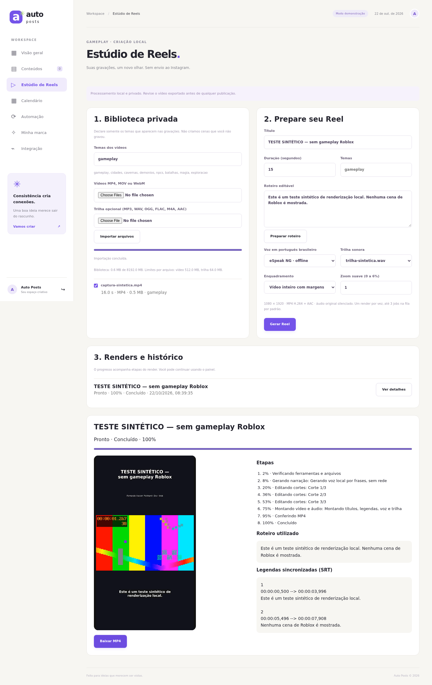

# Estúdio de Reels pelo navegador — Fase 2

> Documentação histórica das Fases 1/2. Para o estado atual, veja [Auto Posts completo](auto-posts-completo.md).

A Fase 2 acrescenta uma página ao painel existente. Reutiliza biblioteca, planejamento, voz, legendas e renderizador da Fase 1. FastAPI, autenticação, SQLite, automação e publicação de imagens continuam existentes. Não há agendamento ou envio de Reels à Meta nesta fase.



## Instalação e início no Ubuntu 24.04

No checkout atualizado, execute uma vez:

```bash
cd auto-dev-marketing
bash scripts/install-reels.sh
```

O instalador usa Python 3.12/venv, FFmpeg e eSpeak NG dos repositórios oficiais. Não exige GPU dedicada, serviço pago ou Node para executar o painel. Dependências são baixadas na instalação; importação e render são locais. A narração padrão é eSpeak NG pt-BR. Piper é opcional, exige um modelo pt-BR já instalado e não baixa modelos automaticamente.

Se você já configurou as variáveis do servidor, **preserve APP_PASSWORD, DATA_DIR e suas credenciais**. O app lê o ambiente de processo, não carrega `.env` automaticamente. Para usar o seu arquivo local existente:

```bash
set -a
source .env
set +a
.venv/bin/python -m app
```

Se ainda não configurou senha, informe-a no seu próprio terminal sem gravá-la no histórico. Use pelo menos 12 caracteres. Não substitua uma senha existente:

```bash
if [ -z "${APP_PASSWORD:-}" ]; then
  read -rsp 'Senha local do painel (mínimo 12 caracteres): ' APP_PASSWORD
  echo
  export APP_PASSWORD
fi
.venv/bin/python -m app
```

Abra **http://127.0.0.1:8000**, entre e escolha **Estúdio de Reels**. É uma URL do seu computador Ubuntu, não uma prévia pública deste ambiente na nuvem. A porta muda se configurar `APP_PORT`. Para verificar o servidor, `curl --fail http://127.0.0.1:8000/health` deve retornar `{"status":"ok"}`.

O padrão do projeto permanece `APP_MODE=demo`. A geração de Reels nunca chama serviços de IA nem a Meta, inclusive quando o painel existente opera em modo real. Não altere o modo de uma instalação existente sem verificar seus agendamentos de imagens.

Sem `APP_PASSWORD`, o painel antigo de demonstração continua funcionando localmente, mas **todas as rotas do Estúdio retornam 503** e a página explica como habilitar login. Com senha, todas exigem sessão válida, inclusive vídeo, textos e downloads; anônimos recebem 401. Execute **um único worker** com o comando acima. Não use `uvicorn --workers 2` ou recarga automática durante renders.

## Gerar o primeiro Reel sem comandos de edição

1. Abra **Estúdio de Reels** e escolha seus MP4, MOV ou WebM. Declare somente temas realmente presentes: `gameplay`, `cidades`, `cavernas`, `demonios`, `npcs`, `batalhas`, `magia`, `exploracao`. Separe por vírgulas. Clique **Importar arquivos** e acompanhe a barra; após o envio, o servidor valida o conteúdo com ffprobe.
2. Opcionalmente importe sua trilha em MP3, WAV, OGG, FLAC, M4A ou AAC pelo mesmo formulário. Use material com autorização de uso.
3. Marque os vídeos na biblioteca. Ela mostra duração, contêiner identificado, tamanho e temas. Novos vídeos importados já vêm selecionados. Duplicatas por conteúdo reutilizam o registro e unem os temas.
4. Defina título e duração inteira entre 15 e 60 segundos. A soma das gravações selecionadas com os temas solicitados precisa cobrir a duração. Não repetimos nem inventamos cenas para completá-la.
5. Clique **Preparar roteiro**, revise o texto e ajuste-o. O botão refaz o texto a partir dos temas; use-o antes de sua edição final. Se deixar vazio ao gerar, o planejamento cria um roteiro local. Um roteiro próprio deve corresponder ao que você gravou. Textos longos demais para a duração falham sem acelerar ou cortar a fala.
6. Escolha voz, trilha, enquadramento e zoom de 0 a 6%. **Vídeo inteiro com margens** preserva o HUD; **Preencher com corte central** pode cortar elementos laterais. O áudio original é silenciado; a trilha usa volume baixo junto à voz. A duração final não é a duração da trilha.
7. Clique **Gerar Reel**. A fila persiste no SQLite e o painel continua disponível. O progresso atualiza a cada 2 segundos com etapas, eventos e erros. **Ver detalhes** abre qualquer job do histórico; **Cancelar render** encerra somente aquele job e seus subprocessos, ou remove sua execução pendente da fila.
8. Ao terminar, reproduza no navegador, confira roteiro e legendas SRT e clique **Baixar MP4**. A saída é 1080×1920/30 fps, H.264/yuv420p + AAC estéreo/48 kHz com faststart. Ela não é publicada nem aprovada para publicação automaticamente.

As legendas vêm dos tempos medidos da narração por frases, não da transcrição do áudio do gameplay. Para usar Piper, instale `requirements-reels-piper.txt`, obtenha legalmente um modelo pt-BR e seu `.onnx.json`, e configure `REELS_PIPER_MODEL=/caminho/local/voz.onnx` no ambiente do servidor antes de iniciar. A seleção Piper só aparece quando modelo e sintetizador estão disponíveis; caminhos de modelos não são recebidos do navegador.

## Limites e proteção de recursos

| Variável | Padrão | Efeito |
| --- | --- | --- |
| `REELS_UPLOAD_MB` | 512 | MiB por vídeo |
| `REELS_MUSIC_MB` | 64 | MiB por trilha |
| `REELS_STORAGE_MB` | 8192 | MiB na árvore privada, incluindo originais e intermediários |
| `REELS_MIN_FREE_MB` | 1024 | Reserva livre no disco |
| `REELS_THREADS` | 4 | Threads do render; 1–8, reduza para 2 se necessário |
| `REELS_QUEUE_LIMIT` | 3 | Total de jobs web pendentes/em execução; 1–10 |
| `REELS_TIMEOUT_SECONDS` | 900 | Tempo máximo por job web |
| `REELS_FILE_LIMIT_MB` | 512 | Limite Linux por arquivo produzido pelo worker |
| `REELS_PIPER_MODEL` | vazio | Modelo pt-BR local opcional |
| `REELS_PROXY_UPLOAD_LIMIT` | 513MB | Limite de corpo no Caddy somente para a rota de upload |

Os limites em MiB são multiplicados por 1024². A biblioteca reserva espaço para temporário e cópia antes do upload; um upload por vez é aceito. O tamanho declarado e os bytes recebidos precisam coincidir. Extensões são limitadas e o conteúdo é inspecionado; nomes com separadores, controles ou caminhos são recusados. Não há confiança no MIME informado pelo navegador. Falhas removem os temporários de upload.

O supervisor executa um render por vez, com prioridade CPU reduzida e grupo de processos próprio. O processo filho recebe somente variáveis necessárias às ferramentas locais, sem senha do painel, token Meta ou chave de IA. Monitora espaço e tempo a cada segundo. Ao cancelar ou encerrar o servidor, termina o grupo correspondente com SIGTERM e, se necessário, SIGKILL. No Linux, o worker também reage à morte inesperada do pai; no próximo início, jobs web em execução são marcados interrompidos. Jobs ainda na fila continuam após reiniciar. Nenhuma sinalização utiliza PIDs persistidos no banco.

Os limites de disco são controles de aplicação, **não uma quota rígida do filesystem**: pode haver ultrapassagem entre verificações. Reserve espaço para intermediários e mantenha as ferramentas do sistema atualizadas. O limite por arquivo e a serialização reduzem picos. Não há limite rígido de RAM nem garantia de tempo real; o alvo é Ryzen 7 5700U/Vega 8/12 GB usando CPU, sem benchmark realizado nesse hardware.

Arquivos ficam em `DATA_DIR/reels`, nunca em `/media` ou `/static`. Preview e download usam IDs, caminhos fixos e verificação de contenção, ignorando caminhos arbitrários na requisição. Requisições de faixa permitem seek no navegador. Roteiro e SRT também exigem sessão; não há link público de vídeo. Não exponha a pasta privada em outro servidor web.

Intermediários, fontes e logs são mantidos para diagnóstico. **Ainda não há exclusão/limpeza pelo painel ou retry automático.** Ao atingir o limite, pare o servidor, faça backup e inspecione os diretórios de jobs antes de arquivar intermediários antigos; não remova o SQLite, a chave de sessão ou a biblioteca inteira. Reels cancelados podem deixar intermediários privados e nunca ficam disponíveis para download. Não há retomada de um render interrompido; gere outro job.

Esta entrega foi preparada para execução nativa no Ubuntu. A imagem Docker original do painel não instala FFmpeg/eSpeak; o Compose/Caddy mantém seus limites de proxy preparados, mas não constitui uma instalação multimídia. Para o Estúdio, use a instalação nativa documentada ou prepare uma imagem com as ferramentas oficiais. Não alteramos nem contratamos hospedagem.

## Arquitetura e API

`app/main.py` mantém a autenticação, o publisher e o worker de imagens. Adiciona o router `app/reels/api.py` e o lifespan do `ReelService`. `service.py` mantém uma fila serial com trava de supervisor; `worker.py` executa `ReelStudio.render` da Fase 1 num processo Linux separado. O renderizador recebeu apenas suporte a um job já criado e à entrega do estado final de interrupção ao supervisor. A migração SQLite é aditiva (`origin`, `cancel_requested`), com registros antigos identificados como `cli`.

A UI usa `reels.js` e `reels.css`, sem build ou dependência JS adicional. Reutiliza sessão, API helper, navegação e estilo do painel. Todas as rotas abaixo ficam em `/api/reels`:

| Rota | Uso |
| --- | --- |
| `GET /config` | Limites, espaço e vozes disponíveis, sem segredos/model paths |
| `GET /assets` | Biblioteca e metadados sem caminhos privados |
| `POST /assets?filename=...&kind=video&tags=gameplay` | Corpo binário com Content-Length; também aceita kind=music |
| `POST /plan` | Planejamento existente para revisar roteiro |
| `POST /jobs` | Valida e enfileira; 202 com ID |
| `GET /jobs`, `GET /jobs/{id}` | Histórico, etapas, progresso e erros |
| `POST /jobs/{id}/cancel` | Cancela somente jobs web pendentes/em execução |
| `GET /jobs/{id}/video`, `/download` | Preview/MP4 autenticados, somente quando prontos |
| `GET /jobs/{id}/texts` | Roteiro e SRT dos nomes fixos permitidos |

Os uploads binários via XMLHttpRequest permitem progresso real de envio sem adicionar multipart ou carregar o arquivo inteiro na RAM do servidor. A validação/cópia roda em thread; FFmpeg/eSpeak do render rodam no worker separado. O percentual de render indica etapas e cortes, não cada frame. Um render CLI concorrente é protegido pela trava da Fase 1; caso a trava já esteja ocupada, o job web falha sem interferir na CLI.

## Testes reproduzíveis

```bash
REELS_REQUIRE_TOOLS=1 .venv/bin/python -m unittest discover -v
.venv/bin/python -m pip check
node --check app/web/reels.js
# Dependências opcionais somente para o teste de navegador:
.venv/bin/python -m pip install -r requirements-dev.txt
.venv/bin/python -m playwright install --with-deps chromium
.venv/bin/python scripts/browser_smoke.py
.venv/bin/python scripts/reels_browser_smoke.py
```

Se Chromium já estiver instalado, use `BROWSER_EXECUTABLE=/usr/bin/chromium` nos scripts. Os testes usam dados temporários, sem Meta e sem vídeos versionados. O teste novo de navegador faz login, upload, seleção, roteiro, trilha, render real, reprodução, download decodificado pelo FFmpeg, legendas, cancelamento e layout móvel. A CI executa a suíte e os dois testes de navegador no Ubuntu 24.04.

[Resultados e limites da validação desta entrega](reels-web-validation.md). [Documentação do pipeline e CLI preservados](reels.md). Publicação oficial e dois horários diários continuam pertencendo à Fase 3.
